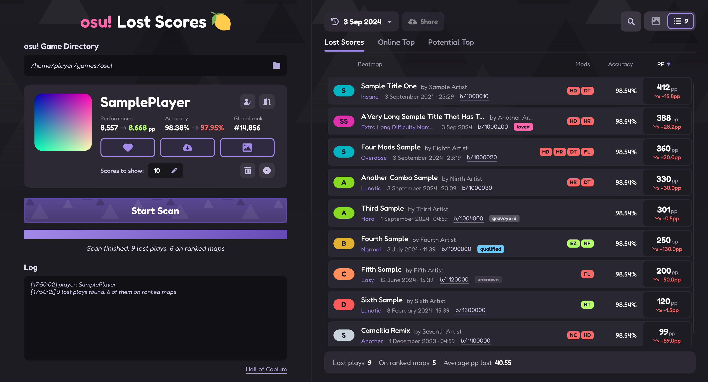
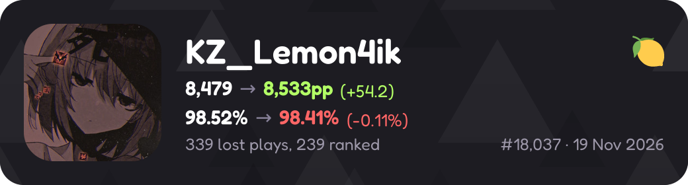
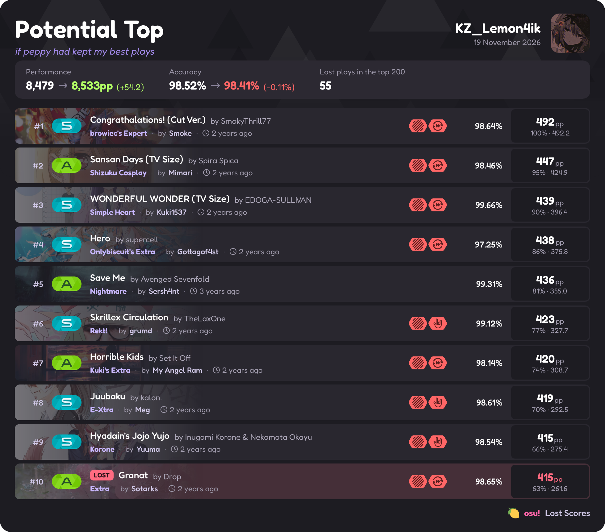
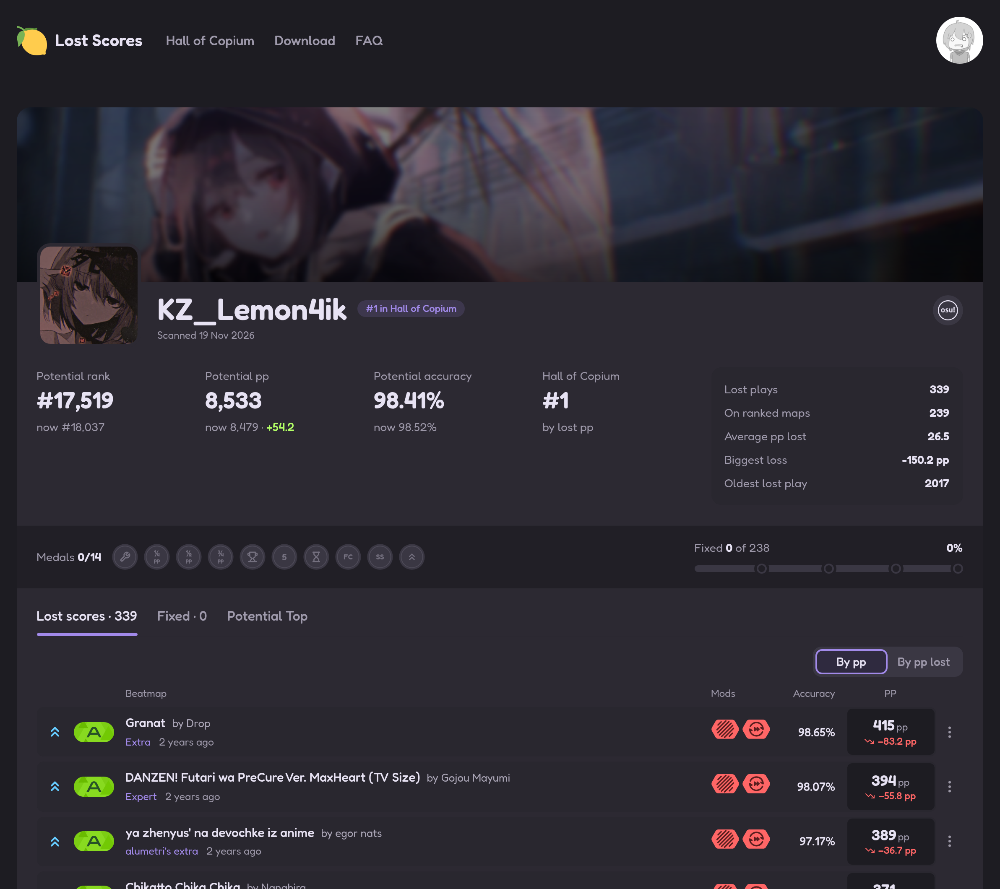

  

<h1 align="center">osu! Lost Scores</h1>

Finds your osu!stable plays that ScoreV1 overwrote and the pp they were worth.

  
  
  
  
  

  <a href="https://lost.lemon4ik.kz">Website</a> ·
  <a href="https://lost.lemon4ik.kz/download">Download</a> ·
  <a href="https://lost.lemon4ik.kz/rankings">Hall of Copium</a> ·
  <a href="https://lost.lemon4ik.kz/faq">FAQ</a> ·
  <a href="https://lost.lemon4ik.kz/privacy">Privacy</a> ·
  <a href="https://lost.lemon4ik.kz/terms">Terms</a>

Until October 2024 the osu!stable server kept one play per beatmap and mod combination: the one with the highest score. A new play with a higher score replaced the old one even when the old play was worth more pp, and a play that scored less than your record was not kept at all. That pp disappeared from your profile. Your local replays still have those plays, and this tool reads them back.

This is a Rust rewrite of the original Python desktop app.

## Download

Get the files from the [latest release](https://github.com/kz-lemon4ik/osu-lost-scores/releases/latest).

- **Windows 10 and 11:** `lost-scores-<version>-windows-x64.exe`. It is one file and needs no installation: put it anywhere and run it. The settings, the keys, the scans and the map catalog are kept in `%APPDATA%\lost-scores`, the downloaded `.osu` files, covers and avatars in `%LOCALAPPDATA%\lost-scores`, so a newer version simply replaces the file. To remove the program, delete the file and these two folders.
- **Linux:** `lost-scores-<version>-linux-x64.tar.gz`, for distributions with glibc 2.35 or newer. Unpack it and run `./lost-scores-gui`, or run `./install.sh` to copy the programs into `~/.local/bin` and add the launcher entry and the icons.
- **macOS 11 or newer on Apple Silicon:** `lost-scores-<version>-macos-arm64.zip`. Unpack it and move Lost Scores to Applications. osu!stable runs on a Mac only through Wine, so pick its osu! folder with the folder button. In that dialog, Cmd+Shift+G opens a path you type or paste, and Cmd+Shift+. shows hidden folders such as `~/Library`, where Whisky and CrossOver keep their bottles.
- On Linux and macOS the settings and the keys are kept in `~/.config/lost-scores`, the scans and the map catalog in `~/.local/share/lost-scores`, the downloaded `.osu` files, covers and avatars in `~/.cache/lost-scores`.
- The command line `lost-scores` comes in the Linux archive and, for Windows and macOS, in `lost-scores-cli-<version>-windows-x64.zip` and `lost-scores-cli-<version>-macos-arm64.zip`. Open a terminal in the unpacked folder and run `.\lost-scores.exe` on Windows or `./lost-scores` elsewhere, or put the program on your PATH to type `lost-scores` as below.
- `SHA256SUMS` has the checksums of every file.

The program is not signed yet, so the first start needs one more step:

- **Windows:** SmartScreen may say "Windows protected your PC". Choose "More info", then "Run anyway". With Smart App Control turned on in Windows 11, an unsigned program cannot start at all and cannot be allowed one by one; that ends when the builds are signed.
- **macOS 15 and newer:** the system says it cannot verify Lost Scores. Choose Done, open System Settings, Privacy & Security, and choose "Open Anyway" next to Lost Scores. On macOS 14 and older, Control-click Lost Scores, choose Open, then Open again. For the command line, run `xattr -d com.apple.quarantine lost-scores` once.

You need osu!stable with your replays, and either your osu! account or the keys of your own osu! OAuth application. Logged in with osu!, the program asks the Lost Scores server, which shares one map cache and one queue between all players; with your own keys it asks the osu! API itself. The program only reads the osu! folder and never changes it.

## Window

The window runs the same scan as the command line. "Log in with osu!" opens osu!'s login in the browser; after it, the scan goes through the Lost Scores server under your account, and a wait in its queue counts down in the status line. When a login expires, the window says so and returns to the login. "Use Custom API Keys" saves the keys of your own osu! OAuth application instead; they are checked before they are saved. With your own keys the player name comes from the osu! config, and the pen next to the name lets you type another name, an ID or a profile link in its place; a player that is not found leaves the name as it was. The door next to the name logs out and deletes the saved login and keys, so you can switch between your account and your own keys.

- The osu! folder is found the same way as in the command line and remembered; the folder button picks another one.
- Start Scan shows the progress and a log. Every finished scan is kept in the scan history, and the results view opens any earlier scan.
- The results open on the pictures of the scan (see Share images). The pictures and list icons at the right of the results header switch to the tables: Lost Scores, Online Top and Potential Top. A click on a column header sorts by it and a second click reverses the order. The magnifier, or Ctrl+F, opens a search that keeps only the plays whose title, artist, difficulty, mapper, mods or date match. A right click on a row copies it as text. The date button lists your scans and opens the folder of the shown scan.
- Logged in with osu!, every finished scan is saved to your profile on the Lost Scores server, where only you see it. Share next to the date brings up the card that publishes the scan in the Hall of Copium; after a scan that lost pp the card shows up by itself, and Not now hides it for that scan. Ticked on the card, the replays of the lost plays in your Potential Top are shared too, so other players can watch them; a play whose replay went out is marked replay, one still waiting replay soon. Waiting replays go out when the window shows the scan again; unpublishing or deleting the scan stops them. A published scan shows Unpublish, with a dot for the state of its check, and the trash button next to it deletes the scan from the server after a confirmation. The server takes five new scans an hour from each account. With your own keys nothing is sent: a scan belongs to an osu! account.
- Below 790 px high the log is hidden, and its newest line shows under the status instead; hover it to read it whole. From 1480 px wide the controls and the results sit side by side; in a narrower window the results open over the controls when a scan ends, See Full Results opens them again, and Back returns to the controls.
- Esc closes the top layer: a menu, a sheet, the search, then the results.
- Once a day the window looks for a new release. A newer release signed by the author is downloaded, checked against its checksum and put in place of the program, which runs it from the next start; the log says so. A copy built from source does not update itself, and Check for updates in About names the new version and opens its page.
- The text of the log can be selected and copied. The log is also written to `log.txt` in the program's data folder (`%APPDATA%\lost-scores` on Windows, `~/.local/share/lost-scores` elsewhere); when it grows past 1 MiB it moves to `log.old.txt` at the next start.
- The settings are shared with the command line. Clear cache removes the downloaded avatars and covers and keeps the scan history, the map catalog and the settings.

On Linux the launcher entry and the icons come from `install.sh`. It copies `kz.lemon4ik.LostScores.desktop` and the lemon icons into `$XDG_DATA_HOME` (`~/.local/share` by default). Under Wayland the window takes its icon from this entry, which has the same app id as the window. On Windows the icon is built into the executable.

## Share images

After every scan the window saves three pictures into the scan's folder:

- `summary_badge.png`: a small card with the main numbers;
- `lost_scores.png`: your lost plays on ranked maps, or on all maps when the scan included unranked and loved ones;
- `potential_top.png`: your top 200 as it would be with the lost plays kept, with the pp and accuracy it would give.

   
  

"Scores to show" sets how many plays the two big pictures list, up to 250. "Ensure at least one lost score is visible" extends the Potential Top down to its first lost play. The pictures are drawn at twice their size from images prepared at exactly that size, so they stay sharp when a chat shows them in full.

The Images mode shows the three pictures of the shown scan one under the other, in that order. A click on a picture opens it in your image viewer, and a right click offers Copy image and Open. The arrows in the corner jump to the previous or the next picture.

The catbox button next to the switch uploads all three pictures to [catbox.moe](https://catbox.moe) and copies their links, one per line. While it uploads, the button counts the pictures. Then it says whether the links were copied, and after a failure its tooltip shows why. A scan made before the images existed has none, and the view says so.

An upload to catbox.moe is anonymous and public: anyone with the link can see the pictures, and catbox keeps each one until nobody has opened it for two years. They cannot be deleted for free, so the window asks before the first upload, and nothing is uploaded without a click.

Covers come from assets.ppy.sh and are cached; Clear cache removes them.

## Scan history

Every finished scan is kept, and the scan list in the results view opens any earlier one. In a narrow window the results open by themselves when a scan ends.

The cross next to an older scan, or "Delete older scans" at the bottom of the list, deletes scans for good after a confirmation. The newest scan always stays.

## Hall of Copium

Published scans go to the Hall of Copium on [lost.lemon4ik.kz](https://lost.lemon4ik.kz/rankings). It ranks players by the pp they lost and single plays by the pp they lost on one map, and every player has a page with the lost plays, the Potential Top and the lost plays fixed since, with medals along the way. Every published scan is checked against osu!, and the rankings show whether the check passed.

## Command line

`lost-scores` finds the osu! folder and remembers it, reads the player name and the Songs folder from the osu! config, calculates pp for your replays and prints the plays that ScoreV1 overwrote, best first. It never writes to the osu! folder. `lost-scores --help` lists the options with examples and shows where the settings, keys and map data are kept.

- `--all` also shows loved and unranked maps; `--sort date`, `--limit N` and `--json` change the output.
- `lost-scores potential` shows your top 200 as it would be if ScoreV1 had kept your best plays: the potential pp and accuracy, and which lost plays would be in it.
- `--check-missing` also finds lost plays on maps you no longer have in Songs. It downloads only the maps that can hold a lost play into the map cache; the first run takes a few minutes.
- `lost-scores login` logs in with your osu! account in the browser; then your player and the statuses of your maps come from the Lost Scores server. Maps it already knows come back at once; new ones wait in its queue, which asks osu! for all players together within the osu! rate limit, and a wait counts down on the progress bar. The browser has to run on the same computer as the program; over SSH, use your own keys.
- `lost-scores login --keys` saves the keys of your own osu! OAuth application (create one at https://osu.ppy.sh/home/account/edit), and the program then asks the osu! API itself: the first run asks about the statuses and ranked dates of your maps, about 180 requests for a few thousand maps, and later runs only about new maps; statuses that can still change are asked again once a week. Long steps show a progress bar with the time left. `--offline` stays offline, `lost-scores logout` logs out and deletes the keys. `LOST_SCORES_CLIENT_ID` and `LOST_SCORES_CLIENT_SECRET` work instead of saved keys.
- `lost-scores submit` scans like the window, keeps the scan in the history and sends it to your profile on the Lost Scores server, where only you see it; `--publish` also puts it in the Hall of Copium and `--replays` shares the replays of the lost plays in your Potential Top; `lost-scores replays` later sends the ones that had to wait. It needs `lost-scores login`: a scan belongs to an osu! account, so your own keys are not enough. The server takes five new scans an hour from each account.
- `--osu-dir`, `--player` and `--songs-dir` override the detection. Options of a command go after it: `lost-scores potential --limit 100`.
- `--timings` prints how long each step took.
- `lost-scores scan --output replays.json` dumps every replay of the player with its beatmap and pp, for checks. For checks too, the table and `lost-scores potential` take a hidden `--maps <file>` that uses another map catalog instead of the saved one.

## Privacy

The program has no telemetry. It goes online for these things and nothing else:

- logging in opens osu!'s login page through the Lost Scores server, which keeps your osu! ID, your name and your earlier names, and the session of the program; the program keeps the session in its settings folder, and logging out ends it on the server;
- saving keys, in the window or with `lost-scores login --keys`, checks them with the osu! API;
- the window looks up your player when it starts, for the account card, and loads your avatar from a.ppy.sh;
- a scan asks about your player, your online top and the statuses of your maps; the check for missing beatmap IDs also downloads the `.osu` files of the maps you no longer have from osu.ppy.sh;
- with your keys these questions go to the osu! API; without them they go to the Lost Scores server at lost.lemon4ik.kz, which gets the player name and the beatmap ids and md5 hashes of the maps that can hold a lost play, and asks osu! for them. The server keeps the map statuses for everybody and the player answers for five minutes, and counts the requests of each account per day to share the queue fairly;
- the results load the map covers from assets.ppy.sh;
- once a day, and from Check for updates in About, the window asks GitHub for the latest release, or the mirror at lost.lemon4ik.kz/dl when GitHub does not answer, and downloads a newer signed release from there;
- the catbox button uploads the pictures of the shown scan to catbox.moe;
- with the osu! login every finished scan goes to your private profile on the Lost Scores server: your player, your lost plays and the Potential Top. Only you see it until you publish it, and replays go out only when you share them. The server keeps your 20 newest private scans, and the trash button next to Share deletes a scan.

Your keys and settings stay on your computer, and with your own API keys so do your scans. The full [privacy policy](https://lost.lemon4ik.kz/privacy) and the [terms of use](https://lost.lemon4ik.kz/terms) are on the website; logging in with osu! accepts both.

## Build from source

With the current stable Rust:

    cargo install --locked --path crates/lost-scores-gui
    cargo install --locked --path crates/lost-scores-cli

On Linux the window needs the fontconfig development files (`libfontconfig1-dev` on Debian and Ubuntu). After installing, `packaging/linux/install.sh` adds the launcher entry and the icons.

## Credits

- [osu-web](https://github.com/ppy/osu-web) artwork © ppy Pty Ltd (AGPL-3.0), the grade and mod icons and the guest avatar.
- [rosu-pp](https://github.com/MaxOhn/rosu-pp) by MaxOhn (MIT), the pp calculation, through a fork.
- [Slint](https://slint.dev) (GPLv3), the window toolkit.
- [Fredoka](https://fonts.google.com/specimen/Fredoka) (OFL 1.1, the licence is in `crates/lost-scores-gui/assets/OFL.txt`).
- [Font Awesome Free](https://fontawesome.com) (CC BY 4.0), the icons.
- [Twemoji](https://github.com/jdecked/twemoji) (CC BY 4.0), the lemon; the app icon adds a violet shadow behind it.

## License

[AGPL-3.0-only](LICENSE)

Copyright (c) 2026 KZ_Lemon4ik
